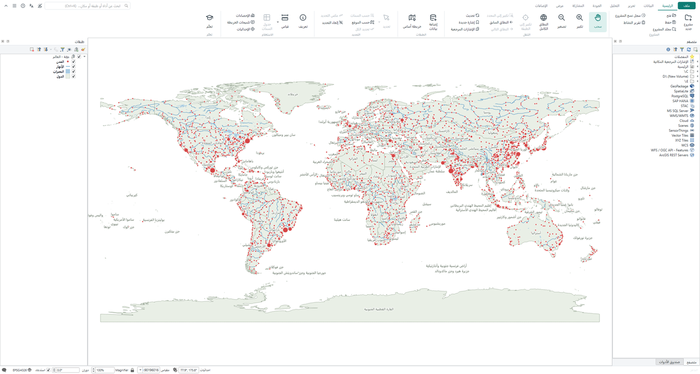

  

<h1 align="center">Biruni GIS</h1>

  <b>نظم معلومات جغرافية مكتبية مجانية ومفتوحة المصدر لويندوز. قِس العالم وارسمه وحلّله.</b> 
  بلا حساب · بلا رخصة تنتهي · بلا رصيد (credits) · يعمل دون إنترنت

  
  
  
  

  <a href="https://hatemtarekgis.github.io/biruni-gis/?lang=ar"><b>الموقع</b></a> ·
  <a href="https://github.com/HatemTarekGIS/biruni-gis/releases/latest"><b>التنزيل</b></a> ·
  <a href="README.md"><b>English</b></a> ·
  <a href="https://github.com/HatemTarekGIS/biruni-gis/issues">الإبلاغ عن مشكلة</a>

  

**Biruni GIS** برنامج نظم معلومات جغرافية مكتبي للمسّاحين والمهندسين والطلاب وكل من يعمل
بالخرائط. يضع واجهة شريطية حديثة، ودعمًا كاملًا للعربية من اليمين إلى اليسار، وأدوات جاهزة
للمشاريع الحقيقية فوق محرك QGIS المجرَّب.

> **حالة الإصدارات.** الإصدار الحالي هو **0.2**. العناصر المعلَّمة بـ **0.3** مكتملة وتصل مع
> الإصدار التالي.

## لماذا البيروني؟

- **مجاني للجميع وللأبد.** استخدمه في العمل والجامعة والمنزل، على أي عدد من الأجهزة (GNU GPL).
- **مِلكُك.** لا تسجيل دخول ولا خادم رخص، ولا يرسل البيروني أي شيء من تلقاء نفسه.
- **مألوف.** تبويبات شريطية، ومربع بحث يجد أي أداة (حتى باسمها في ArcGIS)، وصفحة بداية ودروس موجّهة.
- **العربية كما ينبغي.** واجهة كاملة من اليمين إلى اليسار، وتسميات عربية صحيحة، وأرقام عربية في
  لوحات الخرائط. وتصل الإسبانية والبرتغالية والفرنسية والتركية والفارسية في **0.3**.

## قادم من ArcGIS؟

انتقل دون أن تخسر شيئًا، وعُد متى شئت.

| الميزة | الإصدار |
|---|---|
| فتح مشاريع وخرائط وملفات طبقات **ArcGIS Pro** ‏(aprx وmapx وlyrx) بالطبقات والمجموعات والألوان والتسميات والفلاتر | 0.2 |
| فتح مستندات **ArcMap** ‏(mxd)، وقراءة **File Geodatabase** والكتابة فيها | 0.2 |
| **رموز ArcMap** ‏(mxd وlyr): تطابق نوع الترميز في 99.9% من 1,307 طبقات حقيقية، والألوان في 98.3% | 0.3 |
| **تشغيل سكربتات arcpy** دون رخصة: نحو 200 دالة (Cursors والهندسة وBuffer وClip وDissolve وSpatial Join وProject…) على shp وGeoPackage وFile Geodatabase | 0.3 |
| **فحص الجاهزية للانتقال**: اختر مجلداتك واحصل على تقرير (HTML وExcel) بما سيفتح 100% من الخرائط والسكربتات والنماذج، وما سيتغير، وما ينقص | 0.3 |
| استيراد نماذج **ModelBuilder** ‏(atbx) إلى صندوق الأدوات | 0.3 |
| **الحفظ لـ ArcGIS Pro**: ملفات aprx وmapx وlyrx بالرموز والتسميات والمخططات، مع التحقق منها بفتحها في ArcGIS Pro 3.x | 0.3 |
| استيراد **مخططات Pro** ‏(aprx وpagx) كمخططات طباعة | 0.3 |
| خدمات **ArcGIS Server وPortal وOnline**: التصفح والإضافة والتحرير، أو العمل دون اتصال ثم المزامنة مع كشف التعارضات | 0.3 |
| صفحة «قادم من ArcGIS Pro؟»: ما ستوفّره، وزمن التشغيل مقيسًا على جهازك، وما لا تجده إلا في البيروني | 0.3 |

غير مدعوم بعد: قواعد الطوبولوجيا والخصائص المخزنة في الـ geodatabase، والنطاقات (Domains)،
والأنواع الفرعية (Subtypes)، والإصدارات (Versioning)، وبعض مطابقات الحقول. ويعرضها فحص الجاهزية
لملفاتك أنت.

## أبرز المزايا

| المجال | ما تحصل عليه |
|---|---|
| المشاريع | المشروع **مجلد واحد**: الخريطة وGeoPackage المشروع و`data/` و`outputs/` و`exports/` · نسخ كل البيانات إليه بنقرة · حزمه في ZIP · **آلة الزمن**: كل حفظ نسخة يمكنك استعادتها · **0.3:** التعديلات غير المحفوظة تنجو من انقطاع الكهرباء |
| البيانات | Shapefile وGeoPackage وFile Geodatabase وDXF/DWG وCSV/Excel وGeoTIFF وPostGIS وWMS/WMTS/WFS وXYZ · **من Excel إلى نقاط** مع اكتشاف أعمدة الإحداثيات تلقائيًا · **بيانات مفتوحة**: OpenStreetMap وSentinel-2 والارتفاعات 30 م والغطاء الأرضي والحدود الإدارية · **0.3:** نافذة «إضافة بيانات» جديدة تتعرّف على نوع البيانات فور إضافتها وتعرض محتوى ملفات gdb |
| الكاد والمساحة | من DXF إلى GIS بالنصوص والبلوكات والأقواس الحقيقية وخطوط SHX العربية · التوقيع بنقطتين أو هلمرت أو الأفيني · COGO · تقسيم القطع · محوّل الإحداثيات |
| الجودة | **افحص بياناتي** مع إصلاحات آمنة · قواعد الطوبولوجيا · قواعد الخصائص · **0.3:** شرح الأخطاء بلغة بسيطة، ودستور البيانات |
| التحليل | نحو 1,370 أداة (GDAL وGRASS وSAGA) في صندوق أدوات مرتب حسب المهام · تحليل الشبكات · الهيدرولوجيا بنقرة · **0.3:** الإحصاء المكاني مع مستشار، وأسطح الأرض والأحجام من الليدار ونقاط الطائرات المسيّرة |
| المكتب الهندسي (0.3) | ما نظام إحداثيات هذا الملف؟ · مواصفات التسليم وفحصها · مقارنة نسختين · جدول الكميات · من نص الصك إلى القطعة · الارتدادات · القطع من مخطط ممسوح ضوئيًا |
| الخرائط والمشاركة | لوحة خريطة بنقرة · خريطة ويب في ملف HTML واحد · KMZ · QField · **0.3:** مراجعة الخريطة من العميل دون حساب، وختم ملفات التسليم، ورموز QR حية على الخرائط المطبوعة |
| الميدان والهاتف (0.3) | GPS الهاتف، والصور والنماذج الميدانية، والفريق على الخريطة، ومشاركة الخريطة مباشرة من متصفح أي هاتف، بلا تطبيق ولا حساب سحابي |
| الحماية (0.3) | قفل قاعدة البيانات أو المشروع بكلمة مرور · مستخدمون دون اتصال بصلاحيات لكل طبقة · سجل نشاط موقّع |
| السجلات | تقرير النشاط (Excel) وسجل ساعات العمل |

## التثبيت

1. نزّل `Biruni-GIS-<version>-Setup.exe` من
   [صفحة الإصدارات](https://github.com/HatemTarekGIS/biruni-gis/releases/latest).
2. شغّله. ملف التثبيت غير موقّع رقميًا بعد؛ إذا ظهر تحذير من ويندوز فاختر
   *More info ← Run anyway*.

مع كل إصدار دليل PDF بالعربية. يتطلب ويندوز 10/11 بنظام 64-bit ونحو 2.5 جيجابايت من مساحة القرص.
يحفظ البيروني إعداداته في `%APPDATA%\Biruni GIS` بشكل مستقل، فلا يمس أي تثبيت سابق لـ QGIS.

## البناء من المصدر والمساهمة

خطوات البناء وبنية المستودع في [README.md](README.md#build-from-source). نرحب بالمشكلات والأفكار على
[GitHub Issues](https://github.com/HatemTarekGIS/biruni-gis/issues)، ولتحسين الترجمة عدّل ملفات JSON في
[`app/plugins/biruni/i18n`](app/plugins/biruni/i18n).

## الرخصة

رخصة GNU العمومية الإصدار 2 أو أحدث؛ انظر [LICENSE](LICENSE) و[NOTICE.txt](NOTICE.txt).

«QGIS» علامة تجارية لـ QGIS.org، وBiruni GIS مشروع مستقل مبني على QGIS وغير معتمد من مشروع QGIS.
وArcGIS وExcel وAutoCAD وWindows علامات تجارية لأصحابها، ولا يرتبط بهم Biruni GIS ولا يحظى باعتمادهم.

---

سُمّي البرنامج باسم العالم **أبي الريحان البيروني** (973–1048) الذي قاس الأرض من قمة جبل بزاوية
انخفاض الأفق، وهي الفكرة التي يرسمها الشعار.

