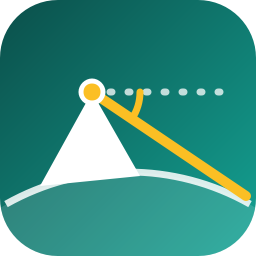

<p align="center">
  
</p>

<h1 align="center">Biruni GIS</h1>

<p align="center">
  Free and open-source desktop GIS. Measure, map and analyse the world.<br>
  <b>English</b> · <b>العربية</b> · Windows · Based on QGIS
</p>

---

Biruni GIS is a desktop GIS for surveyors, engineers, students and everyone who
works with maps. It puts a modern, simple ribbon interface on top of the proven
QGIS engine, so you get a familiar way of working without giving up any of the
power underneath.

Named after **Abu Rayhan al-Biruni** (973–1048), who measured the radius of the
Earth from a mountain top using the dip angle to the horizon - the idea behind
the logo.

## Highlights

- **Ribbon interface** - Home, Data, Edit, Analysis, Quality, Share, View and
  Plugins tabs; every QGIS menu is still one click away (☰), and a *Classic
  Menus* switch restores the original QGIS layout.
- **Search everything** - tools, layers, places and settings from the search box
  (Ctrl+K).
- **English and Arabic** - full right-to-left interface in Arabic; switch from
  the language button or the start page.
- **Light and dark themes** - or follow Windows.
- **Project folders** - a new project is a folder that keeps everything together:
  `<Name>.qgz`, a project database `<Name>.gpkg` (new and temporary layers are
  saved there), and `data/`, `outputs/`, `exports/`. Data added from elsewhere
  can be copied in with one click; *Package as ZIP* makes it portable. Or start
  a *temporary map* and save it as a project folder later (Ctrl+S).
- **Toolbox** - about 125 hand-picked tools in 18 task-based categories, with
  search (English and Arabic), favourites, recent tools and descriptions; all
  ~1,370 QGIS/GDAL/GRASS/SAGA algorithms remain one click away.
- **Biruni tools** - Find overlaps and gaps · Add area, length and coordinates
  (any unit, true ellipsoidal size) · Number features in reading order ·
  Export layers to a folder (GPKG/SHP/GeoJSON/KML/CSV/XLSX/DXF).
- **Start page** - new project, temporary map, open a project, open data,
  ArcGIS Pro or ArcMap project, points from Excel, sample map, lessons, recent projects.
- **All the formats** - Shapefile, GeoPackage, File Geodatabase (read/write),
  DXF/DWG, CSV, GeoTIFF, PostGIS, WMS/WMTS/WFS, XYZ tiles and more.
- **Free, offline, no account.**

### New in 0.2

| Area | What you get |
|---|---|
| Coming from ArcGIS | Open **ArcGIS Pro projects** (.aprx/.mapx/.lyrx) with layers, groups, colours, labels and definition queries · open **ArcMap documents** (.mxd): layers, groups, visibility, definition queries and data sources, in default styles · write **File Geodatabases** · type an ArcGIS tool name in the search box and get the Biruni tool |
| Data in a minute | **Excel/CSV to points** that finds the coordinate columns by itself (degrees, DMS, UTM, Google Maps/WhatsApp links, WKT, Arabic digits) · **Open data**: OpenStreetMap, Sentinel-2 imagery and NDVI, 30 m elevation with hillshade, 10 m land cover with class areas, administrative boundaries · bundled world sample |
| CAD and survey | **CAD to GIS** (closed polylines → polygons, texts → labels, blocks → points with attributes, true arcs, Arabic SHX) · move a drawing to real coordinates (2-point / Helmert / affine) · **COGO** panel (bearings & distances, misclosure, compass rule) · **subdivide parcels** by equal parts or area · coordinate converter (DD/DMS/UTM/MGRS) |
| Data quality | **Check my data** (one scan of every layer, safe fixes) · **topology rules** · **attribute rules** (required, unique, value lists, ranges, automatic area/date/user/number) |
| Analysis | **Closest facility** and **OD matrix** on road networks (one-way streets, speeds) |
| Hydrology | **Streams and watersheds from a DEM in one click** (sinks filled, Strahler order, basin areas) · a Hydrology category with the GRASS and SAGA tools: fill sinks, flow direction and accumulation, stream extraction, watershed above an outlet, wetness index (TWI), LS factor · all ~590 **SAGA GIS** tools in Processing |
| Maps and sharing | **Map sheet in one click** (frame, north arrow, scale, legend, corner coordinates table; Arabic RTL with Arabic-Indic digits) · **web map in one HTML file** · KMZ for Google Earth · **send to QField and bring the edits back** · portfolio page |
| Safety | **Project history**: every save is a version you can restore; the activity log is never rolled back |
| Work records | Activity report (Excel) and a **timesheet** with hours, work done per day and amounts |
| Phone GPS | Live track from a phone over Wi-Fi/Bluetooth/USB, or **from the phone's browser by scanning a QR code** (experimental) |
| Help | **Learn** panel with guided lessons and the ArcGIS ↔ Biruni dictionary · problem reports · update notices |

## Install

Download `Biruni-GIS-<version>-Setup.exe` from the
[releases page](https://github.com/HatemTarekGIS/biruni-gis/releases/latest) and run it.
An Arabic PDF guide is attached to each release.
Windows 10/11 64-bit, about 2.5 GB of disk space.

## Build from source

Requirements: Windows 10/11 x64, PowerShell, the .NET Framework 4.8 C# compiler
(part of Windows), Python 3 (for helper scripts), Inno Setup 6.

```powershell
# 1. Get the engine: the official QGIS installer (OSGeo4W MSI)
#    https://download.qgis.org/downloads/QGIS-OSGeo4W-4.2.3-2.msi  ->  _downloads\
# 2. Release build: engine + app + launcher + installer  ->  dist\
powershell -ExecutionPolicy Bypass -File scripts\build.ps1
```

For development, extract the MSI into `engine\` once
(`msiexec /a <msi> /qn TARGETDIR=<tmp>`), run
`app\scripts\engine-postinstall.bat engine`, then:

```powershell
powershell -ExecutionPolicy Bypass -File scripts\build.ps1 -Dev   # build\Biruni GIS.exe
```

### Layout

| Path | What |
|---|---|
| `app/plugins/biruni/` | The Biruni shell (Python): ribbon, start page, themes, i18n, branding |
| `app/plugins/biruni/i18n/ar.json` | Arabic strings (`scripts/extract_strings.py` checks coverage) |
| `app/config/qgis_global_settings.ini` | Engine defaults (no update nags, snapping, basemaps…) |
| `app/boot/biruni_boot.py` | Keeps the shell active even if its plugin was disabled |
| `app/scripts/engine-postinstall.bat` | Prepares the engine on the target machine |
| `launcher/` | `Biruni GIS.exe` - starts the engine with the Biruni profile and shows the splash |
| `installer/biruni.iss` | Inno Setup script (English + Arabic) |
| `scripts/` | Build, branding, icon, string and world-data tools |
| `app/python/` | Bundled Python libraries (cryptography, QR codes) |
| `tests/` | Headless tests - run each with `engine\bin\python-qgis.bat tests\test_<name>.py` |
| `packaging/winget/` | winget manifests for each release |
| `docs/RELEASING.md` | How to publish a release (GitHub, signing, winget) |

Biruni GIS keeps its own profile in `%APPDATA%\Biruni GIS`, so it never touches
an existing QGIS installation.

## Licence

GNU General Public License v2 or later - see [LICENSE](LICENSE) and
[NOTICE.txt](NOTICE.txt) for the engine and third-party components.

"QGIS" is a trademark of QGIS.org. Biruni GIS is an independent derivative built
on QGIS and is not endorsed by the QGIS project. ArcGIS, Excel, AutoCAD and
Windows are trademarks of their owners; Biruni GIS is not affiliated with or
endorsed by them.

## Code signing policy

Release installers are built from this repository by `scripts/build.ps1` and
signed only from that build. Free code signing is provided by
[SignPath.io](https://about.signpath.io), certificate by
[SignPath Foundation](https://signpath.org) (once the application is approved;
until then installers are unsigned and Windows SmartScreen shows *More info →
Run anyway*).

- Committers and reviewers: the repository owner (HatemTarekGIS) and
  collaborators they add.
- Approvers: the repository owner.
- Privacy: Biruni GIS sends nothing anywhere by itself. It connects to the
  internet only for what you ask for (basemaps, open-data downloads) and, once a
  day, to the GitHub releases page to see whether a newer version exists.

---

<div dir="rtl">

## بالعربي

**Biruni GIS** برنامج نظم معلومات جغرافية مكتبي مجاني ومفتوح المصدر، بواجهة شريطية
حديثة وبسيطة فوق محرك QGIS. يدعم العربية والإنجليزية بالكامل، والوضعين الفاتح والداكن،
ويفتح ويحرر Shapefile وGeoPackage وFile Geodatabase وDXF وغيرها، دون حساب ودون إنترنت.

سُمّي البرنامج باسم العالم **أبو الريحان البيروني** الذي قاس نصف قطر الأرض من قمة جبل
بزاوية الانخفاض نحو الأفق، وهي الفكرة التي يرسمها الشعار.

</div>
