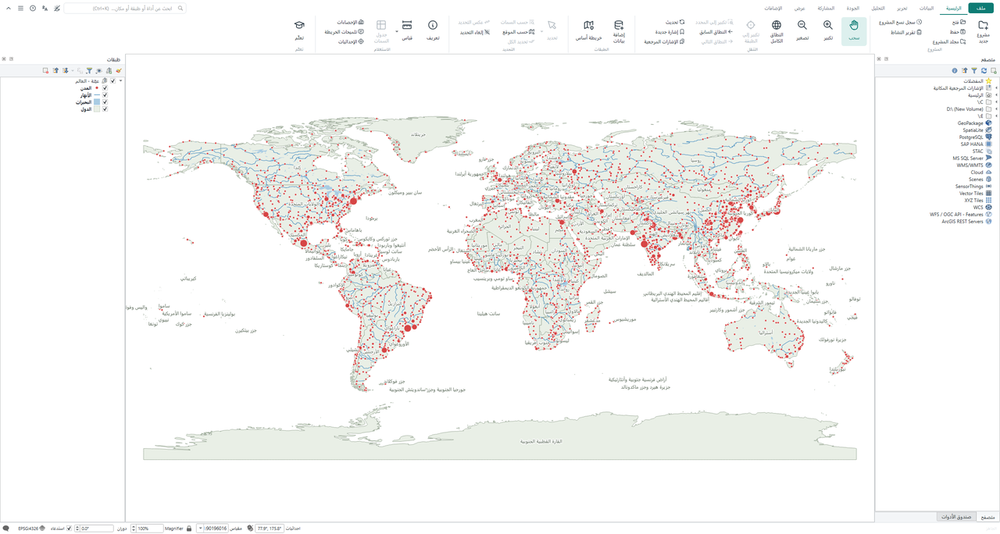

<p align="center">
  
</p>

<h1 align="center">Biruni GIS</h1>

<p align="center">
  <b>Free and open-source desktop GIS for Windows. Measure, map and analyse the world.</b><br>
  No account · no licence that runs out · no credits · works offline
</p>

<p align="center">
  <a href="https://github.com/HatemTarekGIS/biruni-gis/releases/latest"></a>
  <a href="https://github.com/HatemTarekGIS/biruni-gis/releases"></a>
  <a href="LICENSE"></a>
  
</p>

<p align="center">
  <a href="https://hatemtarekgis.github.io/biruni-gis/"><b>Website</b></a> ·
  <a href="https://github.com/HatemTarekGIS/biruni-gis/releases/latest"><b>Download</b></a> ·
  <a href="README.ar.md"><b>العربية</b></a> ·
  <a href="https://github.com/HatemTarekGIS/biruni-gis/issues">Report a problem</a>
</p>

<p align="center">
  
</p>

Biruni GIS is a desktop GIS for surveyors, engineers, students and everyone who works
with maps. It puts a modern ribbon interface, full Arabic right-to-left support and
ready-made tools for real projects on top of the proven QGIS engine.

> **Version status.** **0.2** is the current release. Items marked **0.3** are finished
> and come with the next release.

## Why Biruni

- **Free for everyone, for ever.** Use it at work, at university and at home, on as many
  computers as you like (GNU GPL).
- **Yours.** No sign-in and no licence server. Biruni sends nothing anywhere by itself.
- **Familiar.** Ribbon tabs, a search box that finds any tool (type an ArcGIS tool name
  too), a start page and guided lessons.
- **Arabic done right.** A full right-to-left interface, correct Arabic labels and
  Arabic-Indic digits on map sheets. Spanish, Portuguese, French, Turkish and Persian
  arrive in **0.3**.

## Coming from ArcGIS

Move without losing anything, and go back any time.

| What | Status |
|---|---|
| Open **ArcGIS Pro** projects, maps and layer files (.aprx, .mapx, .lyrx) with layers, groups, colours, labels and definition queries | 0.2 |
| Open **ArcMap** documents (.mxd); read and write **File Geodatabases** | 0.2 |
| ArcMap **symbology** (.mxd, .lyr): renderer type matched on 99.9% of 1,307 real layers, colours on 98.3% | 0.3 |
| **Run arcpy scripts** without a licence: about 200 functions (cursors, geometry, Buffer, Clip, Dissolve, Spatial Join, Project…) on shapefile, GeoPackage and File Geodatabase | 0.3 |
| **Readiness scan**: point it at your folders and get a report of which maps, scripts and models open 100%, which change and what is missing (HTML and Excel) | 0.3 |
| Import **ModelBuilder** models (.atbx) into the toolbox | 0.3 |
| **Save back for ArcGIS Pro**: .aprx, .mapx and .lyrx with symbols, labels and layouts, verified by opening them in ArcGIS Pro 3.x | 0.3 |
| Import Pro **layouts** (.aprx, .pagx) as print layouts | 0.3 |
| **ArcGIS Server, Portal and Online** services: browse, add, edit, or take offline and sync back with conflict checks | 0.3 |
| «Coming from ArcGIS Pro?» page: what you save, start-up time measured on your computer, and what is only in Biruni | 0.3 |

Not supported yet: geodatabase topology and attribute rules, domains, subtypes,
versioning, and some field mappings. The readiness scan lists them for your own files.

## Highlights

| Area | What you get |
|---|---|
| Projects | A project is a **folder**: map, project GeoPackage, `data/`, `outputs/`, `exports/` · copy all data in with one click · package as ZIP · **time machine**: every save is a version you can restore · **0.3:** unsaved edits survive a power cut |
| Data | Shapefile, GeoPackage, File Geodatabase, DXF/DWG, CSV/Excel, GeoTIFF, PostGIS, WMS/WMTS/WFS, XYZ tiles · **Excel to points** that finds the coordinate columns itself · **open data**: OpenStreetMap, Sentinel-2, 30 m elevation, land cover, boundaries · **0.3:** a new Add Data window that recognises the data as soon as you add it and shows what is inside a .gdb |
| CAD and survey | DXF to GIS with texts, blocks, true arcs and Arabic SHX fonts · 2-point / Helmert / affine fit · COGO · subdivide parcels · coordinate converter |
| Quality | **Check my data** with safe fixes · topology rules · attribute rules · **0.3:** plain explanations of errors, data charter |
| Analysis | ~1,370 tools (GDAL, GRASS, SAGA) in a task-based toolbox · network analysis · hydrology in one click · **0.3:** spatial statistics with an advisor, LiDAR / drone ground surfaces and volumes |
| Engineering office (0.3) | What coordinate system is this? · delivery spec and check · compare two versions · bill of quantities · deed text to parcel · setbacks · parcels from a scanned plan |
| Maps and sharing | Map sheet in one click · web map in one HTML file · KMZ · QField · **0.3:** map review by a client with no account, sealed deliverables, living QR codes on printed maps |
| Field and phone (0.3) | Phone GPS, field photos and forms, team on the map and live map sharing from any phone browser, with no app and no cloud account |
| Protect (0.3) | Lock a database or project with a password · offline users with rights per layer · signed activity log |
| Records | Activity report (Excel) and timesheet |

Full notes: [0.2 release notes](docs/release-notes-0.2.0.md).

## Install

1. Download `Biruni-GIS-<version>-Setup.exe` from the
   [releases page](https://github.com/HatemTarekGIS/biruni-gis/releases/latest).
2. Run it. The installer is not code-signed yet: if Windows warns you, choose
   *More info → Run anyway*.

An Arabic PDF guide is attached to each release. Requires Windows 10/11 64-bit and
about 2.5 GB of disk space. Biruni keeps its own profile in `%APPDATA%\Biruni GIS`, so it
never touches an existing QGIS installation.

## Build from source

Requirements: Windows 10/11 x64, PowerShell, the .NET Framework 4.8 C# compiler (part of
Windows), Python 3 (for helper scripts), Inno Setup 6.

```powershell
# 1. Get the engine: the official QGIS installer (OSGeo4W MSI)
#    https://download.qgis.org/downloads/QGIS-OSGeo4W-4.2.3-2.msi  ->  _downloads\
# 2. Release build: engine + app + launcher + installer  ->  dist\
powershell -ExecutionPolicy Bypass -File scripts\build.ps1
```

For development, extract the MSI into `engine\` once
(`msiexec /a <msi> /qn TARGETDIR=<tmp>`), run `app\scripts\engine-postinstall.bat engine`,
then:

```powershell
powershell -ExecutionPolicy Bypass -File scripts\build.ps1 -Dev   # build\Biruni GIS.exe
```

Tests are headless; run each with `engine\bin\python-qgis.bat tests\test_<name>.py`.

<details>
<summary><b>Repository layout</b></summary>

| Path | What |
|---|---|
| `app/plugins/biruni/` | The Biruni shell (Python): ribbon, start page, tools, themes, translations |
| `app/plugins/biruni/i18n/` | Interface translations (`scripts/extract_strings.py` checks coverage) |
| `app/config/qgis_global_settings.ini` | Engine defaults |
| `app/boot/biruni_boot.py` | Keeps the shell active even if its plugin was disabled |
| `launcher/` | `Biruni GIS.exe`: starts the engine with the Biruni profile and shows the splash |
| `installer/biruni.iss` | Inno Setup script (English + Arabic) |
| `scripts/` | Build, branding, icon, string and web-page tools |
| `docs/site/` | The website (published on the `gh-pages` branch) |
| `tests/` | Headless tests |
| `packaging/winget/` | winget manifests |
| `docs/RELEASING.md` | How to publish a release |

</details>

## Contributing

Problems and ideas are welcome on [GitHub Issues](https://github.com/HatemTarekGIS/biruni-gis/issues).
To improve a translation, edit the JSON files in
[`app/plugins/biruni/i18n`](app/plugins/biruni/i18n). See [CONTRIBUTING.md](CONTRIBUTING.md).

## Licence

GNU General Public License v2 or later; see [LICENSE](LICENSE) and
[NOTICE.txt](NOTICE.txt) for the engine and third-party components.

"QGIS" is a trademark of QGIS.org. Biruni GIS is an independent derivative built on QGIS
and is not endorsed by the QGIS project. ArcGIS, Excel, AutoCAD and Windows are
trademarks of their owners; Biruni GIS is not affiliated with or endorsed by them.

## Code signing policy

Release installers are built from this repository by `scripts/build.ps1` and signed only
from that build. Free code signing is provided by [SignPath.io](https://about.signpath.io),
certificate by [SignPath Foundation](https://signpath.org) (once the application is
approved; until then installers are unsigned).

- Committers and reviewers: the repository owner (HatemTarekGIS) and collaborators they add.
- Approvers: the repository owner.
- Privacy: Biruni GIS sends nothing anywhere by itself. It connects to the internet only
  for what you ask for (basemaps, open-data downloads, services you add) and, once a day,
  to the GitHub releases page to see whether a newer version exists.

---

Named after **Abu Rayhan al-Biruni** (973–1048), who measured the Earth from a mountain
top using the dip angle to the horizon, the idea behind the logo.
